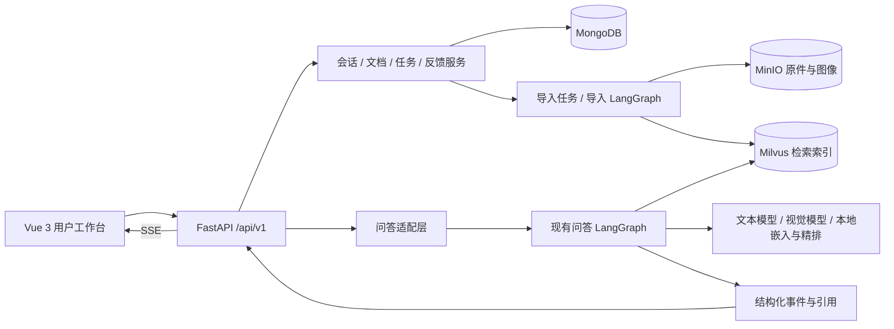

# RAG 项目产品化方向提案

日期：2026-10-22。状态：用于选择方向的研究提案，尚未批准为实施规格。目标岗位：AI 应用 / 大模型应用开发。

预览：[交互原型](index.html)。页面可直接双击打开，不依赖 npm、CDN 或后端。所有 AI 回复、处理单与评测执行均为模拟；少量知识规模基线来自现有导入记录，页面有单独说明。

## 1. 建议先确定的定位

推荐定位为“设备技术支持与知识工作台”：以产品手册为证据，为售后、企业 IT 支持和设备运维人员提供型号澄清、配置与操作指导、处理记录及知识反馈。

推荐组合是方案 A 的业务主线、方案 B 的证据阅读体验，以及共享的知识管理和检索评测模块。三套完整产品不同时开发。

理由：当前资料主要是打印机、网络设备等产品手册，原有型号匹配、多模态切片、图文回答都能直接服务此场景。用户提问时先明确型号，执行指导后记录结果，能建立区别于通用聊天界面的使用流程。题目越明确，越容易用固定问题集验证检索与引用质量。

“企业私域知识”是数据与部署属性，“RAG”是技术实现，都还没有说明具体用户在完成什么任务。面向外部展示时，建议用具体用途做标题，技术栈放在说明中。当前采用云端文本、视觉与 MinerU API；如果继续使用，准确表述应是“私有知识库 / 可自部署应用”，不能承诺所有数据均不出本机或完全离线。

## 2. 对现有代码的判断

| 已有能力 | 代码或记录依据 | 对改造的意义 |
| --- | --- | --- |
| FastAPI 问答、SSE、查询和删除单会话历史 | `app/query_process/api/query_service.py` | 已有后端与简易交互，不需要从零重写整个服务 |
| 文件上传、后台导入、按任务查询进度 | `app/import_process/api/file_import_service.py` | 适合作为知识管理的底座 |
| 图文解析、标题切分、图像关联、向量化 | `app/import_process/agent/` | 可增加导入预览、质量检查、失败重试 |
| 型号匹配、查询改写、混合检索、HyDE、融合与重排 | `app/query_process/agent/` | 可增加型号确认卡片与结构化来源，不必立即换算法 |
| MongoDB 消息记录 | `app/clients/mongo_history_utils.py` | 可增会话目录、问题运行记录、反馈和业务记录 |
| 课程 86 份资料、6,612 个课程切片 | `docs/COURSE_IMPORT.md` | 具备可运行样本，但不是生产部署规模或性能指标 |

直接影响设计的缺口：

- 问答 `QueryRequest` 目前只有 `query`、`session_id`、`is_stream`，没有独立的知识库范围、用户身份、指定产品 ID 或一次问答的运行 ID。
- SSE 以 `session_id` 保存进程内队列，任务状态也是内存字典；同一会话并发、服务重启、多个 worker 与断线恢复都需要明确设计。
- `final` 事件目前主要返回答案、状态与图片地址；前端证据面板需要稳定、结构化的引用对象，不能只解析回答文本中的 `[1]`。
- 切片具有 `file_title`、章节与 `chunk_id`，没有稳定的页码、区域坐标、文档版本关联。不能直接承诺 PDF 原页精准高亮。
- 产品名称和文件名不足以承担业务主键；同名文档、版本重导、知识范围隔离，需要 `document_id`、`knowledge_base_id`、`revision`。
- Mongo 当前消息历史之外，没有完整的用户、文档目录、持久化任务、反馈、评测实验和处理单模块。
- Neo4j 查询节点当前是占位实现，MCP 联网服务配置尚不完整；不能把它们当作已可用的差异化能力。
- Excel 曾通过批量导入脚本转 Markdown 入库；这不等于常规上传 API 已具备完整的 Excel 类型识别、解析和错误处理，需要单独接入验证。

以上是代码阅读与已有验收记录的判断；本轮没有重新执行全量导入或整套模型性能测试。

## 3. GitHub 调研与取舍

2026-10-22 实际调用 GitHub 仓库搜索，关键词包括 `rag knowledge base`、`document chat citations`、`troubleshooting assistant rag`，随后直接读取以下仓库的 README、许可证及部分源文件。个别仓库 API 因限流返回 403，改用可访问的 GitHub 页面和 raw 内容；没有编造星标和最新发布时间，也没有部署这六套系统。

| 项目 | 实际参考内容 | 可以借鉴 | 本项目暂缓 |
| --- | --- | --- | --- |
| [RAGFlow](https://github.com/infiniflow/ragflow) | README 的切片可视化、可追溯引用、文档处理与 agentic retrieval；前端依赖 | 文档目录 → 解析状态 → 切片检查 → 引用证据 | 换掉现有引擎、照搬完整知识编译与平台架构 |
| [kotaemon](https://github.com/Cinnamon/kotaemon) | README 的多模态问答、私有/共享资料集、PDF 引用预览与高亮 | 回答旁边看原文、引用带来源和相关性信息 | 把 Gradio 页面直接当作产品前端；未经元数据改造承诺精准定位 |
| [AnythingLLM](https://github.com/Mintplex-Labs/anything-llm) | README、React/Vite 依赖、`server/models/workspace.js` | 知识空间、选定资料范围、会话组织与检索设置 | 引入其 Node 后端重写现有 FastAPI、实现全部模型适配 |
| [Dify](https://github.com/langgenius/dify) | README 的 RAG、LLMOps；检索测试页面源码 | 独立检索测试入口、固定问题集、运行记录和反馈 | 低代码画布、插件市场、通用 Agent 搭建平台 |
| [Onyx](https://github.com/onyx-dot-app/onyx) | README 的企业搜索、连接器、权限、引用与产物；Next/React 依赖 | 搜索与答案并列、按知识范围访问、问题处理成果 | 50+ 数据连接器、企业 SSO、跨系统权限同步 |
| [Open WebUI](https://github.com/open-webui/open-webui) | README 的会话、知识库、用户组、评价；Svelte 依赖 | 流畅会话体验、资料选择、结果反馈与历史管理 | 成为支持所有模型/工具的通用聊天平台 |

直接查阅过的源码例子：

- [AnythingLLM 的工作空间模型](https://github.com/Mintplex-Labs/anything-llm/blob/master/server/models/workspace.js)：包含工作空间检索阈值、topN、模型、提示词与访问关联等字段。
- [Dify 的检索测试界面](https://github.com/langgenius/dify/blob/main/web/app/components/datasets/hit-testing/index.tsx)：检索配置、测试操作、权限条件和结果状态独立于最终聊天界面。
- [RAGFlow 前端依赖](https://github.com/infiniflow/ragflow/blob/main/web/package.json)、[AnythingLLM 前端依赖](https://github.com/Mintplex-Labs/anything-llm/blob/master/frontend/package.json)、[Onyx 前端依赖](https://github.com/onyx-dot-app/onyx/blob/main/web/package.json)：说明这些产品的交互层可以与检索后端保持边界，但不意味着它们可直接接到当前 API。

仓库 README 中的原界面图片，可对照查看：

- [RAGFlow 切片演示](https://raw.githubusercontent.com/infiniflow/ragflow-docs/refs/heads/image/image/chunking.gif)
- [kotaemon 文档问答界面](https://raw.githubusercontent.com/Cinnamon/kotaemon/main/docs/images/preview.png)
- [Open WebUI 界面](https://github.com/open-webui/open-webui/blob/main/demo.png)

检索返回的一些专用运维助手样例只有少量星标，适合看场景，未作为成熟工程架构依据。搜索结果和观察到的仓库 commit 记录在 `research/`。仓库默认分支会变化，不能把 README 中的全部能力当作每个历史版本都支持。

许可对“个人品牌重做”的直接影响：AnythingLLM 为 MIT；RAGFlow 与 kotaemon 为 Apache-2.0；Dify 使用带多租户及品牌条件的定制许可；Open WebUI 现许可证含品牌保留条款与例外；Onyx 的社区部分与 `ee` 目录许可不同。本提案参考交互模式，原型独立编写，未移植其产品源码。后续若复用具体代码，按相应版本保留所需许可说明。原课程代码的来源与再分发范围仍按项目现有 `NOTICE.md` 处理。

## 4. 方案 A：设备技术支持与知识工作台（推荐）

候选名称：**知衡 ZhiHeng**。功能性副标题：设备技术支持与知识工作台。

用户：售后支持、企业 IT 支持、新入职的设备操作人员。现阶段选打印机和网络设备两个资料范围演示，避免声称已有工业传感、设备接入或预测性维护能力。

主流程：选择或描述设备 → 型号不明确时点选确认 → 提问 → 流式获得操作指引 → 点击引用查看章节/图示 → 将指引转为步骤清单 → 记录执行结果或生成处理单草稿 → 错误或缺失资料进入反馈队列。

主要页面：

1. 技术支持工作台：会话列表、当前设备卡、聊天、操作清单、右侧引用面板。
2. 设备与资料目录：型号、关联手册、可用知识范围；先做轻目录，不做资产管理系统。
3. 处理记录：问题、设备、证据、建议、用户填写的执行结果与状态。
4. 知识管理：上传、任务、文档、切片预览、版本和失败重试。
5. 检索实验室：题集、策略、证据命中、耗时和人工审核。

有价值的 AI 改造：

- 模型澄清结果结构化返回，不让前端从自然语言中猜型号。
- 答案区分操作步骤、前提、引用与缺失信息；正文仍流式显示。
- 对“未解决”收集现象与已尝试操作，继续检索，控制最大轮数和证据预算。
- 处理单从已确认信息生成草稿，经用户确认保存，字段不得把推测标为事实。
- 反馈关联具体运行、引用与错误类型，经人工筛选进入回归集。

收益：数据最适配、演示路径具体，能够展示 RAG 如何进入业务过程。难点：型号约束、消息与业务记录关联、证据溯源、重试与并发状态。

第一版把操作清单做成问答成果，不把用户打勾解释成设备状态验证。后续确需 Agent 时，再加入有限轮次的“补充信息 → 检索 → 校验 → 生成草稿”工具编排。使用 LangGraph 并不自动等于已经实现自主 Agent。

## 5. 方案 B：文档阅读与研究工作台

候选名称：**页知 PageNote**。功能性副标题：可溯源的文档阅读与研究工作台。

用户：需要读产品规格、方案材料和说明文档的人。用途可扩展到技术选型、学习资料和方案对照；当前样本先保持设备文档，不把课程计划文件包装成业务数据。

主流程：建资料集 → 选择参与问答的文档 → 左栏资料、中栏原文、右栏笔记与回答 → 追问并跳转来源 → 对比选中资料 → 保存带引用的笔记 → 导出 Markdown。

主要功能：资料范围选择、章节预览、引用摘录、选文追问、笔记管理、多文档对比表。对比时每份资料独立检索，表格每一项保留对应证据；没有证据的参数显示“未找到依据”。

AI 深度：查询分解、逐文档召回、证据对齐、笔记引用校验，避免跨产品拼接成错误结论。

收益：原文与问答结合自然、可用于日常阅读，视觉效果直观。难点：精准页码高亮、扫描 PDF、跨文档信息对齐；当前固定产品主体路由需要改为可选模式，不能只换页面。该方向的成熟竞品较多，自己的差异应明确为“技术资料对照与有引用的成果”，而非仅做聊天 PDF。

## 6. 方案 C：团队知识检索与自助服务台

候选名称：**知域 KnowSpace**。功能性副标题：团队知识检索与自助服务台。

用户：团队成员与知识维护者。场景：成员搜索已发布资料、提问获取来源；维护者处理知识缺口并审核常见问题。

主流程：进入可访问知识空间 → 搜索或提问 → 看搜索结果及综合答案 → 查看引用 → 标记未解决 → 维护者补充/修订资料 → 审核发布问答 → 问题回归验证。

主要功能：基础角色（维护者/成员）、知识空间、搜索与对话、反馈队列、常见问题审核、资料维护。先用演示账号和少量手工导入资料验证流程。

AI 深度：多知识范围检索、基于角色的可访问证据过滤、知识缺口归类、审核问答生成与回归验证。

收益：适合讲企业应用完整性，也更方便未来团队使用。难点：需要换入制度/SOP/FAQ 等真实、允许使用的资料；权限必须贯通文档列表、检索、引用接口、MinIO 文件和消息历史。仅前端隐藏按钮不算隔离。现有产品主体确认不能强制用于所有团队问题，需要按场景路由。

## 7. 比较与工作量

| 维度 | A 技术支持 | B 文档研究 | C 团队知识 |
| --- | --- | --- | --- |
| 与当前设备资料适配 | 高 | 中高 | 中，需要补资料 |
| 个人项目区分度 | 高，任务与证据闭环清楚 | 中，需聚焦技术对比 | 中，易变成通用知识库 |
| AI 应用可讲深度 | 型号澄清、检索约束、成果与回归 | 分解、逐文档检索、证据对齐 | 范围检索、权限、反馈与发布 |
| 主要新增难点 | 状态与业务记录 | 页码定位、长文与对比 | 权限与知识治理 |
| 演示版参考区间 | 4–6 周 | 4–7 周 | 6–9 周 |

估算以单人熟悉 Python、每天约 4–6 小时、当前基础链路可复用为前提；包括基础交互与一条闭环，不包含商业系统完整性。前端熟悉度、解析质量和版本迁移会影响区间。稳定性与性能需要另做验证，不用这些数字承诺上线时间。

## 8. 推荐技术边界

采用独立前端与模块化 Python 后端，继续使用已有模型与存储。主要选型建议：

- 前端：Vue 3 + TypeScript + Vite、Vue Router、Pinia、Tailwind CSS + shadcn-vue、TanStack Vue Query；PDF 原件通过 PDF.js 封装。后台工作台无明显 SEO 需求，暂不必为此上 Next.js。
- 后端：FastAPI 管理 API、领域服务与 RAG 适配层；导入图与问答图保留。新增统一 `/api/v1`，旧接口短期保留用于回归。
- 流式：沿用 SSE；为一次执行分配 `run_id`，与持久会话 `conversation_id` 分开。未来需要双向音视频时再考虑 WebSocket。
- 数据：MongoDB 管理资料目录、会话、任务、反馈、处理单和实验；Milvus 管理检索索引；MinIO 管理原件与图像。当前不因“做产品”额外引入关系数据库、图数据库或微服务。
- 长任务：单机小规模演示可以先 Mongo 持久化状态 + 单 worker 调度；需要服务重启恢复和更明确的排队重试时，增加 Redis + 一种任务队列（如 Celery）。Celery 在 Windows 本机开发的进程池限制要考虑，建议队列/worker 放到 Docker Linux 环境。队列不是越多越好。
- PDF：先章节/切片溯源；需要精准原页时，补页码和坐标后接入 PDF.js。
- 部署：前端同源入口反向代理 API，后端负责凭据。前端不得拿到模型 API Key 或 MinIO 管理密钥。

这是逻辑边界，不表示每个框都独立起容器。先避免多个 Python 服务重复加载本地模型占用显存；导入和问答并发时要限制嵌入任务，并测量 CPU 精排与 GPU 使用。

## 9. 数据与接口的关键变化

建议新增最小业务模型：

| 对象 | 重要标识与字段 | 原因 |
| --- | --- | --- |
| documents | document_id、knowledge_base_id、revision、original_object_key、状态 | 文件同名不再是业务主键 |
| import_jobs | job_id、document_id、阶段、错误、尝试次数 | 刷新或重启后可以查询并重试 |
| conversations / messages | conversation_id、user_id、product_id、message_id | 会话列表、归属和结构化结果 |
| query_runs | run_id、conversation_id、策略/模型/数据版本、耗时 | 问答隔离、追踪与可重复对比 |
| citations | citation_id、document_id、revision、chunk_id、章节、可选 page/bbox | 引用和原件稳定关联 |
| feedback / cases | 运行与消息引用、错误原因、草稿内容、审核状态 | 反馈与支持流程可追溯 |
| eval_sets / experiments | 问题、标准证据、策略、快照、结果 | 让改进结论有可比较的依据 |

事件建议：`run.started`、`entity.candidates`、`entity.confirmed`、`stage.changed`、`answer.delta`、`citations.ready`、`answer.completed`、`run.failed`。展示节点阶段与证据，不向用户展示或声称提供模型的隐藏思维链。

`citation_id` 在单次回答内对应 `[1]` 等编号，后端验证引用确实来自本次授权候选。来源链接由文档注册表解析，不能直接信任模型自由生成的文件 URL。提供受控文件接口；长期部署使用受权访问或有期限的签名地址。

对失效情况的明确行为：文档解析失败留原因并允许重试；某检索分支不可用时标记降级；模型超时/限流返回可重试状态；用户中断时区分“断开 SSE”和“后端任务取消”；没有支持结论的证据时说明不足，不填充推测。第一版若无事件重放能力，重连先查询任务状态和已保存最终结果，不宣称已实现断点续传。

## 10. 推荐分期：先做一条可验收路径

1. **产品骨架与真实问答**：统一入口、会话列表、当前设备、流式回答；兼容原图，真实连通已有知识库。验收：一个真实问题、一次追问、一次型号澄清，刷新能恢复历史。
2. **证据与资料管理**：结构化引用、章节预览、资料目录、持久化导入任务。先用 2–3 份资料验证新标识与版本映射，再迁移更多资料。验收：每条引用找到正确原文，文档重导不串资料，失败状态可查看。
3. **技术支持闭环**：操作清单、处理单草稿、执行结果、问题反馈。验收：用户核验后保存，有关证据与问题运行都可追踪；错误反馈不会自动变成已审核知识。
4. **可测量改进与展示**：标注 30–50 个问题，覆盖型号模糊、跨型号、无答案、参数与配置、图示需求、多轮追问；比较稠密检索、混合检索、加精排及可选 HyDE。

先记录 Recall@K、MRR、引用有效性/支持程度、正确拒答率、首 token 时间、总耗时及已知 token 用量。回答质量用明确标准人工审核，LLM 评审只作辅助；不知道模型价格或用量时不展示虚构成本。固定数据、模型与策略版本后再声称提升。

首版暂缓：低代码编排器、完整工单平台、大量连接器、复杂多租户、自动控制设备、语音、GraphRAG、盲目更换 embedding、多个自主 Agent。需要时逐项立项。

已有 Milvus、MongoDB 与 MinIO 数据不为本提案重建。迁移采用新增字段/注册表、备份与小样本验证；文件名旧清理规则在新文档 ID 路径中逐步替换，避免覆盖既有资料。

## 11. 名称与简历的表达

| 方向 | 主候选 | 备选 | 标题示例 |
| --- | --- | --- | --- |
| 技术支持 | 知衡 ZhiHeng | 维知 ServiceNote | 知衡——设备技术支持与知识工作台 |
| 文档研究 | 页知 PageNote | 文鉴 DocLens | 页知——可溯源文档研究工作台 |
| 团队知识 | 知域 KnowSpace | 知栈 TeamDesk | 知域——团队知识检索与自助服务台 |

均为概念候选名，未做商标、域名或 GitHub 仓库名可用性核验；英文词也可能被其他项目使用。选定后再统一目录、包名、页面文案与仓库标题，当前不改名。

推荐简历标题：“知衡｜面向设备技术支持的多模态 RAG 工作台（个人项目）”。完成产品化后，可按真实结果描述：

> 面向产品技术支持场景，基于 Vue 3、FastAPI 和 LangGraph 构建设备知识工作台，支持型号交互澄清、图文知识问答、引用原文联动与处理单草稿，通过知识反馈和固定题集对检索与回答效果进行验证。

这段是未来验收后可使用的目标描述，不是当前已经完成的能力。课程底座和自己的独立开发分别说明；个人演示项目不冒称已服务真实企业，不把“企业横向项目”作为未经事实支持的属性。公开仓库保留现有来源说明。

## 12. 这一轮的选择点

推荐确认“A 为业务主线，吸收 B 的证据阅读，加入轻量评测”。如果喜欢原型的另一方向，也可以保留底座更换用途。先看使用流程是否符合你的目标，再细化页面、接口、数据模型和实施顺序；本提案不是批准后端大改的替代品。

已确定：采用 A 技术支持定位，前端使用 Vue 3，优先完整性与技术深度。后续以主计划为准细化子项目规格；真实演示型号与登录方式在对应阶段确定。
