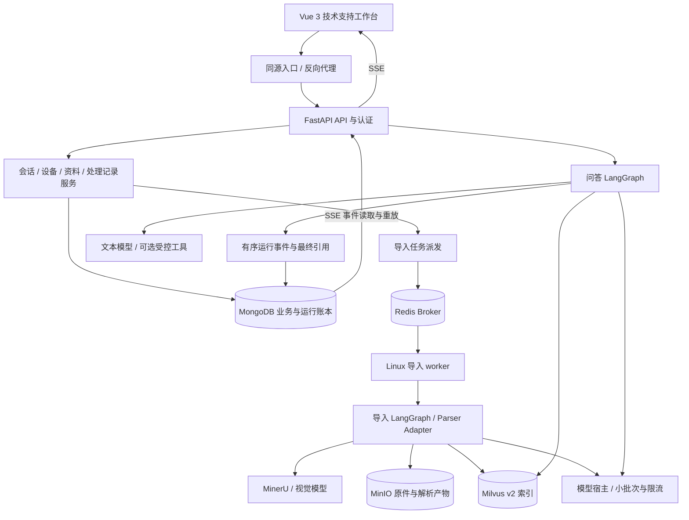
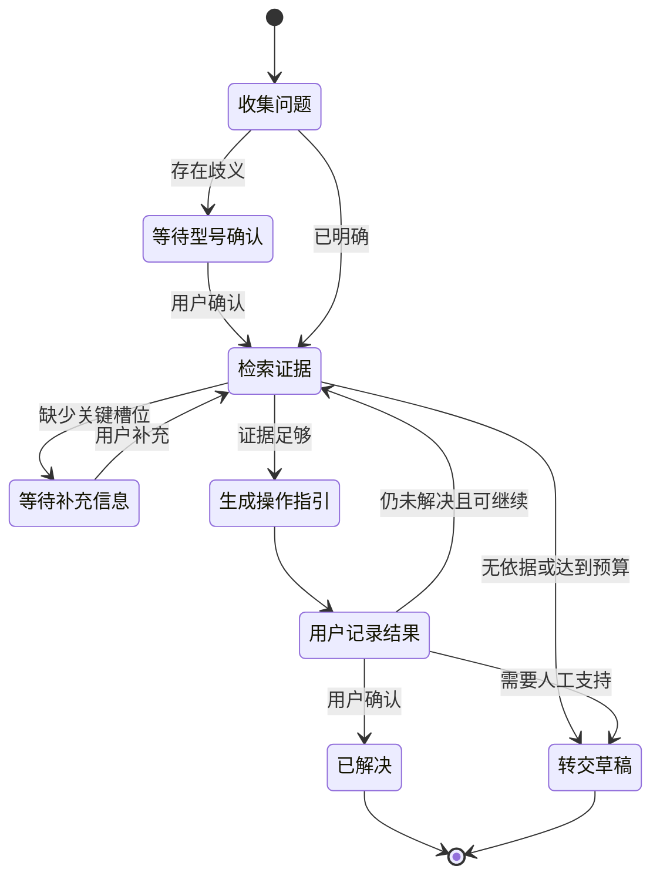
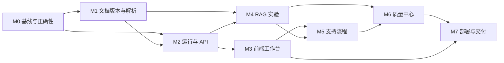

# 设备技术支持与知识工作台：完整优化计划

日期：2026-10-22。

**已确认方向：**A，设备技术支持。优先完整性与技术深度，不设短期交付时限。

**本计划目标：**将现有可运行的课程 RAG 底座，逐步发展为具备前后端、可核验证据、可靠任务、辅助排障、知识维护与效果评测的个人项目。

**当前状态：**规划与研究交付，业务代码尚未改造。产品定位已选定；本文中的实现设计是推荐决策，具体子项目在执行前按相应验收范围细化，不将八个子系统一次性重写。

候选品牌沿用“知衡 ZhiHeng”，名称仍可调整，目录、Python 包和 GitHub 仓库此时不改名。

配套资料：

- [现有代码审查与六项隔离复现](2026-10-22-technical-support-code-audit.md)
- [可复用 GitHub 源码、固定版本与接入方式](2026-10-22-technical-support-reuse.md)
- [交互原型](../brainstorming/2026-10-22/index.html#support)
- [上一轮三种定位比较](../brainstorming/2026-10-22/PROPOSAL.md)

## 1. Brainstorming 收敛：为什么这样做

### 1.1 用户、任务与价值

面向企业 IT 支持、设备售后和设备操作人员。首批围绕已导入的打印机、网络设备手册，帮助用户完成参数确认、安装配置、操作指导与常见现象排查。

产品需要回答三个问题：这是哪台设备的问题；建议依据在哪里；用户尝试后是否解决。前端与后端都围绕这三点组织。

核心使用流程：

> 选择/识别设备 → 确认型号和必要环境 → 获取有来源的指导 → 查看原文与图示 → 按步骤记录操作 → 问题解决或生成转交草稿 → 反馈回流。

这是辅助技术支持系统。用户勾选操作表示其自报执行情况，不能解释为系统已验证设备状态。暂不接设备控制接口，也不虚构传感数据、企业客户或现场维修结果。

### 1.2 三种实现路线的取舍

| 路线 | 优点 | 成本 | 决策 |
| --- | --- | --- | --- |
| **保留当前 RAG、模块化改进、组件级复用前端** | 数据和运行经验延续；可以讲清每项独立改造；前端复用成熟模块 | 需要自行设计业务模型、事件和引用协议 | **采用** |
| 大规模 fork AnythingLLM，再接当前 Python | 成熟界面与工作空间现成 | Node/Prisma 后端与 FastAPI/Mongo 双套状态；适配不只是换 API 地址 | 不作主线 |
| 将检索迁入 RAGFlow/Dify，再做业务客户端 | 平台化功能全面 | 替换检索底座、数据迁移、学习和依赖成本更高 | 不作主线 |

保留：FastAPI、LangGraph、Milvus、MinerU、MinIO、MongoDB、BGE-M3、当前精排模型和已验证问答样本。改进：边界、数据、证据、可靠性与检索策略。添加：Vue 3 工作台、业务记录、评测与治理。可选：可控的 Agent 工具流、外部观测服务。

### 1.3 计划边界

做完整的技术支持工作流，暂不做通用低代码平台、计费 SaaS、插件市场、完整资产管理、大量知识连接器、语音平台、自动操作设备或无依据的 GraphRAG。没有短期限制不等于所有功能都应加入。

只有实验显示瓶颈，才引入新模型、额外数据库或更多进程。当前 GPU 为 6GB 显存的笔记本显卡；模型服务必须先做实测预算，不能照搬大型平台的并发配置。

## 2. 现状与需要优先修复的问题

当前已有上传与聊天 HTML、两个 FastAPI 入口、导入/问答双图及真实知识数据。课程基线为 85 PDF + 1 Excel、6,253 PDF 页、6,612 课程切片；此前独立联调样本另计。数据规模来源于既有验收记录，本轮没有重复统计整库。

六项隔离复现：

1. 最近 10 条消息取到了最早 10 条；长会话的最近追问会被遗漏。
2. 首候选超过 12,000 字时直接停止，后续短证据也被遗漏。
3. 历史正文先加入再检查预算，并重复累计整个字符串；可超过声明预算。
4. M3070 的两个近似高分候选会直接选第一个，缺少交互澄清。
5. 没有父标题的两个不同短章节可能被合并。
6. 流式客户端抛异常后输出节点正常返回部分答案；外层有将其标为 completed 的路径。

此外，从源码确认：任务/SSE 为进程内状态；重排过程丢来源元数据；两路候选在精排前已经缩得很小；文档重导先删后插；原件和图片采用旧文件名/绝对 URL；常规上传尚未吸收批量导入脚本的长文/Excel/恢复能力。详见配套审查表的 A/B/C/D 分类。

这些修复应早于以新模型或更多 Agent 宣称“效果提升”。审查记录是当前行为证据，不是已经修复的声明。

## 3. 产品功能与页面设计

### 3.1 角色与信息架构

先做单组织、多知识库，三种基础角色：

- **支持人员：**问答、维护本人处理记录、提交反馈；只能访问获授权资料。
- **知识维护者：**维护资料与型号、查看导入任务、审核反馈与知识草稿。
- **管理员：**管理用户/角色/知识范围，查看运行与系统配置状态；模型密钥仍在后端。

个人演示可以一人拥有多个角色，不做支付、多租户账务和复杂 SSO。

主要导航：技术支持、设备资料、处理记录、知识管理、质量与评测、系统状态。普通用户默认看到工作台，检索参数和模型细节放管理页面。

### 3.2 技术支持工作台

桌面保持原型的三部分：左栏会话与设备；中间流式回答、操作步骤和追问；右栏证据与图示。右栏可拖动、折叠；手机切换为引用抽屉。

支持会话新建、重命名、归档、搜索、历史分页。会话当前设备可显式切换，历史每一轮保留自己的型号快照，不能因后续确认而回写所有旧消息。

型号确认使用结构化卡片，包括标准型号、系列、别名和适用资料范围。精确型号、系列和近似候选分开：例如明确 M3070DXF 不因语义相近自动改成 DHF。确认后携带 `product_id`，后端复核归属后才执行范围检索。

答案包含正文、必要前提、引用与可选操作步骤；正文优先流式出现，最终引用与步骤作为结构化产物补齐。不能为了拿完整 JSON 等整个回答结束后才展示文字。

运行中的实际阶段使用“确认型号、查找资料、整理指引”等可核实状态。不给用户展示原始模型思维链，也不播放假进度。

### 3.3 证据查看

分三层建设，逐层验收：

1. **章节/切片溯源：**点击 [1] 查看本次使用的完整切片、文档名、标题路径和图示。
2. **原件页码定位：**解析保留页码；点击引用打开正确修订的 PDF 对应物理页。
3. **区域高亮：**有 bbox 时高亮文字、表格或图示；无 bbox 时只定位页/章节，不伪造精确位置。

物理页码与手册印刷页码分别记录。分段解析合并时补回原件 page_offset；坐标要记录原点、范围、页面旋转与尺寸，并归一化。Excel 使用工作表与单元格，Markdown 使用章节/行，不强造 PDF 页码。

每个引用只能指向本次实际纳入证据预算、通过知识访问检查的内容。图片仅绑定使用到的证据，避免从全部候选随意取图。

### 3.4 设备与知识管理

设备目录管理 `product_id`、品牌、型号、系列、别名、关联手册。资料可以适用于系列或多个型号，不能再用一个 LLM 生成的名称作为唯一事实。

知识管理提供上传、原件、解析任务、章节和切片预览、错误说明、重试、版本、发布与撤回。对解析降级或不确定的产品识别显示待核验状态，由维护者确认。

支持 PDF/Markdown/Excel；其他格式后续按业务需要加入。上传入口明确支持范围，不能对未解析类型返回“导入完成”。课程计划 Excel 可留作解析测试，默认不进入设备支持的可检索资料范围。

### 3.5 处理记录与知识反馈

处理记录保存设备、现象、环境、引用、建议、用户自报执行结果、解决/未解决状态与下一步。状态为草稿、处理中、已解决、需转交、归档；它是轻量支持记录，不发展为完整工单分派系统。

“生成处理单”生成草稿，用户检查补齐再保存。不得把 AI 建议自动写成已完成操作。支持导出 Markdown，后续有实际需求再做 PDF。

反馈类型至少包含型号错误、证据不支持、资料缺失、步骤无效和图片不相关。反馈关联运行和引用；知识维护者审核后，才成为回归问题或新知识，避免错误答案自动污染知识库。

## 4. 推荐架构：模块化应用与受控长任务

### 4.1 选型

| 模块 | 推荐 | 理由 |
| --- | --- | --- |
| 前端 | Vue 3 + TypeScript + Vite + Vue Router | 使用 Composition API 与单文件组件；后台工作台无需 SEO |
| 组件 | shadcn-vue + Tailwind CSS，复用其 Reka UI 基础组件 | 复制可定制的侧栏、对话框和分栏源码，统一中文业务交互 |
| 状态与聊天 | Pinia + `@tanstack/vue-query`；自有 Vue 聊天组件与 SSE composable | Pinia 管运行/界面状态，Vue Query 管服务数据缓存；聊天协议与后端保持一致 |
| 原件预览 | PDF.js（`pdfjs-dist`），封装 Vue 组件 | 自部署资源、明确 worker 和字体版本；自写来源定位 |
| 后端 | FastAPI + Pydantic 模型；现有 LangGraph 经适配迁入 | 保留运行经验，按领域切出小模块 |
| 业务数据 | MongoDB | 复用已有部署，适合文档/任务/消息/反馈；不额外引入 SQL 数据库 |
| 检索与原件 | Milvus + MinIO | 保留现有基础设施，新增稳定标识和受控文件访问 |
| 长任务目标态 | Redis + Celery，Linux worker | 解析、重试、图像批任务需要持久运行账本与可恢复调度 |
| 评测 | 自有检索指标 + 可选 Ragas | 确定性证据标签优先，LLM 评价辅助 |
| 观测 | run/stage 结构化记录；Langfuse 可选 | 本机先控制基础设施资源，不强制部署整套观测平台 |

具体库版本在兼容性验证通过后写锁文件，不把今天 default branch 当未来固定安装版本。GPU 版 PyTorch、CPU 环境分别提供可重复安装配置，修复当前 `uv sync` 可能恢复非预期构建的环境差异。

前端按用户选择统一为 Vue 3。Vue Router 承载工作台、资料、处理记录与评测页面；路由守卫只负责导航体验，授权仍由后端执行。Vue Query 缓存会话列表、资料和任务快照；Pinia 按 run ID 保存流式增量、当前设备和界面选择，不另存一套服务数据副本。运行终止后失效相关查询；退出登录时清理缓存并关闭流。`useRunStream.ts` 负责事件去重、重连和组件卸载清理，取消操作另发后端取消请求。

聊天默认复用基础组件，自写 `ChatThread.vue`、`ChatComposer.vue`、`ProductClarification.vue` 与 `EvidenceCard.vue`。assistant-ui 已有 Vue 包，但本轮观察版本为 0.0.5，默认 AI SDK 示例依赖 React，共享 runtime 的免 React 接法另需适配与构建验证；仅作备选研究，不作为首版依赖。Naive UI、vue-pure-admin 作为后台表格/布局的备选参考，不同时引入第二套组件系统。

### 4.2 逻辑架构与运行单元



这是目标边界，先保留一个 API 入口，避免为每个业务模块起微服务。问答图的异步供应商调用和模型宿主可并行推进；导入进入独立 worker，防止长文解析占用 Web 进程。

本机阶段：Vue 3/Python API/模型宿主可在 Windows 运行；现有基础设施、Redis 和 Celery worker 在 Docker Linux 运行。导入 worker 仅接收对象键与业务 ID，不能依赖 Windows 绝对路径；经内部可配置地址访问模型宿主。后续 Ubuntu 部署用 Compose DNS 与挂载目录，内部地址随运行拓扑调整，不承诺 `.env` 永远不变。

模型宿主先通过一个接口抽象适配本地调用；并发/显存测试显示多进程重复加载时，再启用独立推理进程。目标是单份 BGE 权重，查询优先、导入小批运行；精排先保留 CPU，比较耗时后再决定 GPU 分配。不是一开始把所有模型同时塞进 6GB 显存。

### 4.3 预计代码边界

```text
frontend/src/
  app/                         # Vue Router、登录入口、页面布局
  stores/                      # Pinia 登录与界面状态；服务数据交给 Vue Query
  components/ui/               # 有来源记录的可复用组件
  features/chat/               # 会话、输入、流与型号卡片
  features/evidence/           # 引用、图片、PDF 定位
  features/products/           # 型号与资料目录
  features/documents/          # 上传、任务、预览与版本
  features/cases/              # 操作记录和处理单草稿
  features/evaluation/         # 题集、实验与复核
  lib/api/                     # 类型与客户端；不含密钥
app/
  main.py                      # lifespan、路由、异常和同源策略
  settings.py                  # 统一环境配置与能力检查
  identity/                    # 用户、会话登录与授权
  conversations/               # 会话、消息与产品上下文
  runs/                        # 执行状态、事件、取消与恢复
  knowledge/                   # 文档、版本、切片与发布
  products/                    # 产品规范化、别名与适用范围
  ingestion/                   # 可恢复解析与索引流水线
  retrieval/                   # 候选结构、过滤、策略、融合、精排
  answering/                   # 上下文预算、引用、生成与核验
  support/                     # 清单、处理记录、草稿与反馈
  evaluation/                  # 题集、runner 与指标
  infrastructure/              # 模型、存储、队列和外部工具适配
  import_process/              # 迁移期旧入口，逐步缩为兼容层
  query_process/               # 迁移期旧入口，逐步缩为兼容层
tests/{unit,integration,contract,e2e}/
evals/{datasets,configs}/
scripts/{migrations,verification}/
docs/{architecture,reuse,runbooks}/
```

这是迁移目标，不在第一步重命名全部现有文件。新功能先走新的领域模块，旧函数通过适配层逐步替换，避免同时改目录、算法、模型和数据。

## 5. 数据、运行与协议

### 5.1 标识体系

业务 ID 使用稳定 UUID/ULID 等字符串；现有 Milvus 64 位主键与 Mongo ObjectId 对前端一律转字符串，避免 JavaScript 数值精度丢失。

| 对象 | 主要字段 | 关键约束 |
| --- | --- | --- |
| users / login_sessions | user_id、角色、状态、会话过期 | 用户名唯一；密码只存哈希；登录会话可撤销 |
| products / aliases | product_id、品牌、系列、标准型号、别名 | 标准型号与别名分离；系列不冒充具体型号 |
| knowledge_bases / access | kb_id、名称、成员/角色范围 | 单组织即可；授权条件由后端生成 |
| documents | document_id、kb_id、名称、原件 hash、active_revision_id | 文件名仅展示；ID 与文件名无关 |
| document_revisions | revision_id、document_id、parser/model/prompt 版本、对象键、状态 | 修订不可变；未校验不发布 |
| sections / chunks / assets | section_id、chunk_uid、revision_id、heading_path、page_refs、asset_ids、原始文本/派生描述 | 原文与模型图像描述区分；切片定位可追踪 |
| import_jobs | job_id、阶段、attempt、lease、retry_at、错误、恢复点 | 同任务可重试；阶段产物可复用 |
| conversations / messages | conversation_id、owner、逐轮 product_snapshot、message_id、结构化答案 | 历史不因后续确认而改写；消息唯一客户端请求号 |
| query_runs / run_events | run_id、message_id、策略与数据快照、状态、seq、耗时 | 活动运行按会话串行；事件有序且可去重 |
| cases / feedback | 引用运行、产品、用户自报操作、结果、草稿、审核状态 | 不把 AI 推测当执行事实；审核后发布 |
| eval_sets / experiments | 问题标签、标准证据、配置、模型/数据版本、seed、结果 | 训练/调参与最终评估分离 |

Mongo 为单机 standalone 时不依赖跨集合事务。核心状态放一个文档中用条件更新；需要跨对象的一致性采用状态机、幂等键、后台核对和补偿，不能仅写“用事务”却忽略当前部署。

### 5.2 问答 API 与 SSE

API 版本化为 `/api/v1`，提供：

| 路径示例 | 用途 |
| --- | --- |
| `POST /auth/login`、`POST /auth/logout`、`GET /me` | 基础账号与登录 |
| `GET/POST /conversations`、`GET /conversations/{id}/messages` | 会话目录与历史分页 |
| `POST /conversations/{id}/runs` | 创建一次问答；带 client_request_id、问题、已选产品/知识范围 |
| `GET /runs/{run_id}`、`GET /runs/{run_id}/events` | 快照与 SSE，支持游标 |
| `POST /runs/{run_id}/confirm-product`、`POST /runs/{run_id}/cancel` | 型号确认与协作取消 |
| `GET /runs/{run_id}/citations/{citation_id}` | 授权后的原文证据与图示 |
| `GET /assets/{asset_id}` | 授权后的原件/图片，PDF 支持 Range 请求 |
| `GET /products`、`GET /products/{id}/documents` | 型号与资料 |
| `POST /documents`、`GET /import-jobs/{id}`、`POST /import-jobs/{id}/retry` | 上传、导入与重试 |
| `POST /documents/{id}/revisions/{revision_id}/publish` | 校验后发布 |
| `GET/POST /cases`、`POST /feedback` | 业务记录与问题反馈 |
| `GET/POST /eval-sets`、`POST /experiments`、`GET /experiments/{id}` | 评测管理 |

默认同一会话仅允许一个非终态 run，冲突返回 409；跨会话可并行，受到系统推理并发限制。相同 client_request_id 重试返回原运行，避免重复消息与计费。

浏览器使用同源 HTTP-only 登录 cookie；更改状态的请求校验 CSRF 与 Origin。SSE 不在 URL 中放长期密钥。需要桌面或独立客户端时另加明确的 token 流程，不混用多个登录体系。

事件对象统一包含 `run_id`、`seq`、`type`、`at`、`payload`；SSE `id` 为 seq，并以心跳保持连接。阶段事件以有限批次持久化，delta 按约 50–100ms 合并，避免一 token 一写数据库；具体频率由负载测试确定。

事件包括 `run.started`、`product.candidates`、`product.confirmed`、`stage.changed`、`answer.delta`、`citations.ready`、`artifact.ready` 及一个终态事件。终态在 Mongo 条件更新成功后产生，completed/failed/cancelled/interrupted 互斥；澄清时运行进入 awaiting_input，用户确认后继续。

重连携带最后 seq，服务端重放后续事件，客户端按 `(run_id,seq)` 去重。短期事件默认保留 24 小时，最终答案、引用和状态长期保留；游标失效返回明确恢复信号，前端加载最终快照，不能假装补回已过期的增量。

取消是协作式：记录 cancel_requested，网络/模型调用支持时中断；否则等待当前阶段结束并禁止发布最终成功产物。浏览器断开不等同于任务已取消。API 进程崩溃后先将无有效租约的问答标记 interrupted，提供重新运行；不承诺可以精确续传供应商已经中断的 token 流。

### 5.3 长任务恢复

Mongo 是任务状态真相来源，Redis/Celery 是派发与执行机制。创建 job 时在同一个文档写入 dispatch_pending；派发器发送任务后更新派发状态，即使崩溃重发也依靠 worker 的租约与幂等处理。

Celery 按至少一次投递设计；重试不是严格一次执行。每阶段产物按 revision/attempt/hash 存放，worker 条件领取租约、定期续约，过期后可恢复。最终发布比较 attempt/fencing 标记，旧 worker 不得覆盖新尝试的结果。跨系统不会天然事务一致，需要核对任务处理状态和对象清单。

支持供应商 batch_id、分段页范围、产物 hash、已完成图片、嵌入批次恢复。不能每次重启都重新消耗 MinerU/VL 配额。

## 6. 知识工程与安全版本迁移

### 6.1 统一解析模型

定义 `ParsedDocument`，至少包含原件、pages、blocks、tables、images、heading_path、source_spans、parser/version/status。

正式模块吸收全量导入中已验证的实践：按当前供应商限制分段、恢复原件页偏移、合并图文与缓存、Excel 单元格转换、失败 PDF 修复/降级说明。旧 `output/course-import/*.py` 是运行经验，不直接变成线上模块；先抽纯函数和适配器，再补可恢复状态。

MinerU 不是每份文档的唯一策略：原生文本 PDF 可先评估本地解析；扫描 PDF/OCR、复杂表格使用合适解析器；失败退回原生文本/整页图像时显示解析质量，不冒充结构化精确解析。本地解析依赖在引入前核对许可证与 Windows 兼容性，不能直接把批脚本中的所有库搬进公开项目。

### 6.2 切片、图像与表格

- 使用稳定 `section_id` 和完整标题路径；长段切分、短段合并后仍保留原始 source spans。
- 表格、步骤列表、注意事项和图文引用尽可能作为结构块保留；确需拆大表时重复表头并记录行范围。
- 同一系列手册内不同型号的适用范围成为块级标签；不能仅给整本手册一个产品名。
- 子片段用于召回，必要时扩展同一修订的父章节/邻近块，按总预算选择，避免把整章无差别塞入。
- 原图、OCR 原文、VL 描述分别保存；视觉生成的描述不当作手册原文，也不覆盖原件信息。
- 图像摘要缓存 key 包括原图 hash、相关上下文 hash、模型和 prompt 版本；相同图片但不同使用上下文不盲目共享摘要。
- 图像摘要有统一并发、供应商限流和失败重试；失败标记为缺摘要，可以保留原图继续发布或要求人工复核，策略明确。

### 6.3 从 v1 索引迁移到 v2

1. 备份 Mongo、MinIO 与 Milvus，并实际验证恢复样例；旧集合继续服务。
2. 根据本地 manifest、MinIO 原件、现有 file_title 与索引内容建立文档注册表。相同 hash 的不同文件名/型号不自动删除或合并业务关系。
3. v2 采用新集合，加入 `kb_id/document_id/revision_id/chunk_uid/section_id/product_ids/source_refs` 等字段。序号采用足够范围的类型，不沿用 INT8 上限。
4. 优先选择 2–3 份小/长/表格资料做迁移，校验原件、图像、切片与问答；再分批扩展。
5. 每个新修订先写待发布数据，校验数量与引用，确认 Milvus 在约定一致性下可读后，再 CAS 更新 `active_revision_id`。
6. 检索从注册表取得当前获授权的活动 revision 集合，查询前在 Milvus 使用范围与修订过滤；不能依靠 topK 后过滤，否则会影响召回与访问边界。对当前约 86 份资料可使用显式 revision allowlist；规模增长后再评估过滤表达式长度与索引布局。
7. 每次问答固定资料修订快照；发布过程中已开始的问答仍可读取旧修订，避免半新半旧。旧版保留以支持历史引用和回滚，清理必须核对引用保留策略。
8. 采用灰度配置切 v2；任何异常可切回旧集合与注册表版本。确认后再按保留策略回收旧数据，执行阶段不运行 `down -v` 或整库删除。

原件和图片改用对象键/asset_id；已有正文绝对链接先映射、回归检查，再收紧桶策略。直接关闭整桶匿名访问会破坏旧回答配图，不能把这种中断当完成治理。

## 7. RAG 质量优化：用问题类型驱动策略

### 7.1 型号识别与会话理解

建立规范型号/品牌/系列/别名目录，先精确和规范化匹配，再向量候选。融合产品目录分数与上下文，但不把相似度当概率。对两个近似型号、系列级提问、显式切换、跨型号比较、无型号通用问题分别路由。

查询改写保留原始问题和结构化槽位：设备、功能、错误码、现象、环境、已尝试步骤。改写不能把用户没有确认的内容加成事实。最近 N 条窗口修正后，可加入持久的设备与处理状态摘要；摘要版本化、可纠正，不把整个对话无限拼入。

### 7.2 基础检索与候选结构

候选统一为 `RetrievalHit`：业务主键、修订、产品、原文、来源、页/块定位、召回通道、排名与各阶段分数。

保留当前 BGE-M3 dense + learned sparse/Milvus 搜索；learned sparse 不直接标作 BM25。先将候选数、权重、过滤、融合、精排和上下文 topK 独立配置，再做实验。型号和错误码可加规范化关键词召回；是否增加 BM25 使用标注集验证，当前不新增 Elasticsearch 作为默认服务。

RRF 保留原始通道与融合分数，去重采用稳定 chunk_uid + 修订；近重复只在相同产品/修订语境下合并，不删除不同型号的关键差异。召回候选量增大时测精排成本，不能只追求更多上下文。

### 7.3 路由与受控增强

| 问题类型 | 默认路径 | 可控增强 |
| --- | --- | --- |
| 参数/错误码/明确设置入口 | 型号过滤 + dense/sparse + 精排 | 关键词、表格/章节邻接 |
| 模糊症状 | 收集必要槽位 + 本地检索 | HyDE 或有限查询分解 |
| 对比两个型号 | 分型号分别检索 | 对齐字段，每项独立引用 |
| 图示/面板操作 | 文本/图像摘要检索并查看原图 | 在有数据和评测支撑后研究视觉 embedding |
| 库内无依据 | 明确不足并要求补资料/转交 | 用户允许且配置完整时查官方网页 |

HyDE 只生成检索用假设，不能进入回答证据。联网显式标记外部来源、抓取时间与域名，优先厂商官方信息；与本地手册冲突时说明版本与依据，不混作同级事实。MCP 鉴权和服务必须真实验证后启用，缺配置默认跳过并准确记录。

改图时使用明确合并屏障与状态 reducer，覆盖不同分支耗时、超时、空结果和跳过条件，防止新增条件路由引入重复汇合。占位 Neo4j 节点不在正式执行图里保留无产出等待。

### 7.4 上下文、生成与引用校验

按模型可用上下文预留系统提示、当前问题、摘要/最近历史、证据和输出 token，使用实际 tokenizer 或明确的保守估算。保留可配置字符上限作为兼容兜底，不能声称字符数就是 token 数。

选证据时考虑相关性、必要前提、步骤连续性、表格表头与多样性；避免首候选过长导致后面全部丢弃。生成时用编号白名单，最终验编号存在、文档范围与版本匹配、图片合法。高价值或有冲突的技术指引再做额外证据核验，不对每个简单问题强加多次 LLM 调用。

支持无答案、部分支持、需要澄清三种路径。拒答阈值依据问题集校准；“至少留一个重排结果”不能当作有答案。精排失败可降级，但在 run 记录里注明，不能把默认 0 分当真实相关性。

### 7.5 性能与配置治理

先记录分阶段耗时，再比较：减少不必要 HyDE/改写、查询 embedding 缓存、模型预热、小批推理、CPU 线程限制、合理并发、索引参数和网络重试。查询缓存 key 必须包含知识权限、产品、修订和策略；历史/问题变化时不共享错误上下文。语义答案缓存放在后续实验，不默认启用。

统一 provider 配置：模型、供应商、base URL、能力开关、超时、重试、结构化输出模式。温度 0 是合法值；供应商专属参数只对适用 provider 发送。文本、视觉、嵌入、精排分别做 capability check，不以换“最新模型名”代替质量测试。

## 8. 辅助排障：从确定工作流逐步加入 Agent

第一层是可审计的支持状态机：



持久化会话工作流状态，可选使用 LangGraph 的维护中 checkpointer；若新引入第三方 checkpointer，先验证与当前 LangGraph 版本及 Mongo 部署兼容。运行事件、消息历史与图 checkpoint 分工明确，checkpoint 不替代文件/索引阶段账本。

第二层才是工具化增强：`lookup_product`、`search_manual`、`read_evidence`、`draft_checklist`、`draft_case`、可选 `search_official_docs`。工具输入输出按 Pydantic 定义，范围由后端授予，不让模型自由拼 Milvus 表达式或文件路径。

首轮默认至多 2 次扩展检索、3 轮补充信息，采用时间/token 总预算；这些是待基线校准的控制默认，不是经验最优值。无新证据、重复问题、错误反复或用户希望结束时退出并生成转交草稿。高风险操作只保留手册中的适用前提并要求人工核对，不执行设备命令。

草稿、知识发布与处理状态变更是有副作用的操作，需要明确用户确认/维护者审核。确认是产品业务步骤，与本次规划工作的授权是不同层面。

## 9. 评测、可观测性与改进闭环

### 9.1 题集

先人工标注 50 题开发基线，覆盖明确型号、相似型号、长会话、配置步骤、错误码、图示、表格、无依据与跨型号对比；再扩展到约 150 题，至少保留一部分不用于调参的评估集。数字是目标规模，不代表已拥有标准答案。

标签包含预期行为、适用产品、标准文档修订/章节、支持的关键结论、不可接受错误、是否需要澄清/拒答；允许多个有效证据。新切片重建后以稳定文档/章节映射标签，避免只绑定随重导变化的旧 chunk_id。

### 9.2 指标与实验

- 检索：Recall@5/10、MRR@10、nDCG（有分级标签时）、按题型/型号分组。
- 主体：明确型号正确率、歧义应澄清率、误确认率、切换型号与多轮指代准确率。
- 回答：人工关键结论正确性、引用覆盖/支持程度、无依据拒答、跨型号错误、图片相关性。
- 服务：首状态时间、首 token 时间、总时延 p50/p95、阶段耗时、错误/取消率、冷启动、CPU/RAM/显存与队列等待。
- 运行：重启恢复、事件重放去重、幂等、权限与版本一致性。

先比较稠密基线、混合检索、加精排、条件 HyDE、父子片段与分解策略。固定数据/模型/prompt/参数、环境与实验 ID；一次尽量改变一个变量，分别报告检索收益和总耗时。不能把更大模型、更长上下文和重切片同时变化后的结果归因给单个算法。

Ragas 可辅助核验 groundedness/faithfulness，记录评审模型、提示词与抽样复核；模型自评不是事实真值。费用统计只有供应商返回用量并有版本化价格表时才展示，未知成本显示未知。

### 9.3 验收目标与发布准入

固定场景的协议与一致性检查必须全通过：不串会话、未授权不可读、引文可解析到正确修订、重导失败不影响已发布版本、重试不重复发布、取消不误报完成。数据/权限泄漏类失败不以平均准确率抵消。

问答质量和时延的数值门槛在建立首轮真实基线后书面冻结；本计划不编造“提升 30%”或保证某个 p95。优化候选必须说明效果、性能、资源与复杂度取舍；若收益不显著，保留基线。

### 9.4 可观测性

每个 run 记录 trace/run ID、策略、阶段、模型、数据修订、token（若可得）、耗时、错误与降级。默认日志不含整段私有知识、密钥或签名 URL；调试内容采样并脱敏。提供存活 `/health/live` 与就绪 `/health/ready`，后者区分 Mongo/Milvus/MinIO、模型加载与外部供应商能力；探针不反复付费调用 LLM。

反馈 → 人工复核 → 新题或资料修订 → 离线对比 → 小样灰度 → 发布。用户反馈不能自动作为正确标签；资料修改也不绕过审核。

## 10. 源码复用计划

优先使用 MIT / Apache 条件明确的组件和库；完整文件、固定 commit、目标路径和依赖成本见[源码复用清单](2026-10-22-technical-support-reuse.md)。

首批落地：shadcn-vue sidebar/dialog/resizable 的可定制源码；Vue 聊天组件与自有 SSE composable；PDF.js；TanStack Vue Query。UI 自己维护中文业务文案与设计，保留需要的原版权说明。assistant-ui Vue 仅在独立兼容性验证通过后再考虑，具体源码与约束见复用清单。

RAG 的直接参考：kotaemon 的证据格式化与内联引用实现，Dify 的检索测试模式，RAGFlow 的切片管理设计。但它们的数据类/框架依赖不同，不整文件盲拷。Ragas 通过独立评测依赖组使用，Langfuse 作为可选服务。

每一项复制/安装都经过兼容性小样，维护 `THIRD_PARTY_NOTICES.md` 与复用 manifest。截止本轮，属于“已查阅与选型”，不声称已经集成可运行。

## 11. 分阶段任务与验收

使用里程碑依赖，不先承诺总周数。每个子项目形成自己的规格、任务列表与验收记录；先让一个真实问题贯通，再扩资料与能力。

执行入口已细化为[开发 ToDo 总清单](DEVELOPMENT_TODO.md)：78 项固定编号任务及八份阶段计划；[公共契约](DEVELOPMENT_CONTRACTS.md)对齐数据/API/SSE。以下保留阶段概览，不作为第二份完成状态表；实际勾选与验收以开发总清单和[进度页](../development/PROGRESS.md)为准。

### M0：基线、隔离与现有正确性修复

**依赖：**无。**产物：**可重复的旧系统基线和不改变业务范围的缺陷修复。

- 保存当前配置模板、依赖/硬件信息和既有成功问答；敏感值不入记录。建立开发测试集合/桶，避免对现有全库试验。
- 将六项隔离复现转为正式回归：最近消息、上下文超长/预算、型号歧义、独立章节合并、流式失败传播。
- 修正 A01–A06，拆出可测试的纯函数，保持已有正确问答与图文输出。
- 增加终态一致性、错误/重试/降级记录；保留旧接口用于基线对比。

**涉及已有文件：**`app/clients/mongo_history_utils.py`、`node_answer_output.py`、`node_item_name_confirm.py`、`node_document_split.py`、`query_service.py`。新增 `tests/unit/test_history_window.py`、`test_context_budget.py`、`test_product_resolution.py`、`test_chunk_structure.py`、`test_generation_failure.py`。

**验收：**六项原失败场景变为预期行为；已有 `test/test_document_reimport.py` 通过；1 个已知真实型号问题、一次追问、1 个图示问题回归。纯函数测试不访问云 API，真实验证单独标记。**停止条件：**真实行为不确定时先补证据，不混入模型升级。

### M1：文档注册、版本与解析管线

**依赖：**M0。**产物：**稳定资料 ID、可恢复产物与不会先删旧资料的发布路径。

- 定义 products、documents、revisions、chunks/assets 模型与索引；建立旧 file_title/MinIO 对象映射。
- 将解析器、分页分段、Excel 转换、图像缓存从批脚本抽入 `app/ingestion/`，保留 parser 和质量来源。
- 建 v2 索引与注册表；小样验证后再分批迁移，旧集合持续服务。
- 实现 staged → validated → published 发布；基于活动 revision 的检索前过滤；支持撤回和回滚。
- 分层实现章节引用、页码、bbox，恢复不到坐标的旧资料明确标记。

**新增位置：**`app/knowledge/{models,repository,publishing}.py`、`app/ingestion/parsers/`、`app/ingestion/stages/`、`scripts/migrations/register_v1_documents.py`、`scripts/migrations/build_v2_index.py`。先适配旧 `node_pdf_to_md.py`、`node_md_img.py`、`node_import_milvus.py`，不整图同时替换。

**验收：**同名不同文档互不覆盖；同文档重试幂等；插入失败旧版可检索；旧引用可回看；150 页分段合并页码正确；Excel 有 sheet/cell 溯源。迁移脚本有 dry-run、统计与可核对清单。

### M2：统一 API、任务与会话运行协议

**依赖：**M0，使用 M1 的标识；协议设计可与 M1 同步。**产物：**稳定 API、持久运行和基础访问控制。

- 建 `app/main.py` 与统一 settings/lifespan，外部资源初始化移出模块导入副作用。
- 建 identity、conversations、runs；消息/运行 ID 分离、幂等请求、会话归属、同会话冲突控制。
- 实现事件序列、快照、SSE 重连与终态规则；完整贯通型号确认和协作取消。
- 导入任务进入 Redis/Celery 与 Mongo 账本；阶段恢复、租约、重复投递、故障核对。
- 授权文件/引用接口、CSRF/同源策略、上传名称/大小/类型检查；旧图片映射后再收紧访问策略。

**新增位置：**`app/identity/`、`app/conversations/`、`app/runs/`、`app/infrastructure/queue/`、`app/knowledge/api.py`；旧两 API 逐步缩为兼容路由。

**验收：**两会话同时请求不串流；同一请求重发不重复消息；同会话并发有明确冲突；断流重连无重复；取消后不成功；用户 B 不能读 A 的历史/引用/文件；worker 被停止后导入可恢复。故障测试使用测试环境。

### M3：Vue 3 技术支持工作台

**依赖：**M2 的事件/数据契约；静态页面可先做，但不替代契约确认。**产物：**完整真实前后端交互。

- 最小复用兼容性验证：Vue 3 + shadcn-vue + Pinia/Vue Query + 自有 SSE + PDF.js，贯通真实流式问题、取消与引用；冻结 Vue/Tailwind/Reka UI/组件版本及来源。
- 三栏布局、会话管理、型号卡片、流式答案、真实阶段、停止/重试与失败状态。
- 引用抽屉、原图预览、章节内容与逐步加入的 PDF 页码/区域高亮。
- 设备资料目录、上传任务/切片预览与版本发布界面。
- 错误、空状态、慢任务、登录过期、长文/大图、键盘与手机体验。

**新增位置：**前述 `frontend/` 结构；核心边界 `features/chat/composables/useRunStream.ts`、`features/chat/stores/run.ts`、`features/chat/components/ChatThread.vue`、`features/evidence/components/PdfViewer.vue`、`features/evidence/components/CitationOverlay.vue`、`lib/api/client.ts`。跨页面状态放 `stores/`，领域运行状态留在 chat 内。

**验收：**从浏览器登录、选设备、提问、确认候选、查看引用、追问、刷新恢复、导入小样一条链路走通；截图与端到端记录对应真实后端。Markdown 不执行未知 HTML，链接与图片来源受控；前端包和浏览器网络不含后端密钥。

### M4：RAG 质量与性能实验

**依赖：**M1/M2；题集在 M0 后即可开始标注。**产物：**统一候选、可选择策略和真实对比报告。

- 建 `RetrievalHit/QueryPlan/EvidencePack` 模型，全链路保留来源、过滤和阶段分数。
- 规范产品别名与适用范围，改写/澄清/拒答独立决策；把硬阈值移到配置并校准。
- 分别比较候选池、混合权重、重排、父子/相邻扩展、条件 HyDE 与查询分解。
- token 预算、引文白名单、图片一致性与证据不足路径。
- 模型宿主预热、并发与显存预算；测需要后再拆推理进程，不双份重复加载。

**新增位置：**`app/retrieval/`、`app/answering/`、`app/infrastructure/models/`、`evals/configs/`；迁移旧各检索节点为薄适配。

**验收：**固定基线与评估集，输出按题型指标、资源、时延和失败样例；新增策略只在证据支持时成为默认。不能以模型评分代替人工事实判断。

### M5：操作清单、处理记录与有限排障 Agent

**依赖：**M3/M4。**产物：**技术支持业务闭环。

- 结构化步骤绑定引用与适用前提，支持用户记录已尝试与实际结果。
- 处理记录、转交草稿、用户确认、导出；所有未知字段明确未知。
- 持久补充信息/型号确认状态；有限工具、轮数、超时和无进展退出。
- 可选官方网页工具经过真实配置、域名/来源标识和故障降级验证。
- 反馈按运行/证据归类，维护者审核；知识草稿不自动发布。

**新增位置：**`app/support/{models,service,workflow,tools}.py`、`frontend/src/features/cases/`、`app/conversations/context.py`。

**验收：**一次未解决追问能利用已尝试信息，一次缺证据能退出转交，一份草稿经确认保存；工具循环有上限；刷新后能继续补充；用户未确认不声称操作完成。

### M6：质量中心与反馈闭环

**依赖：**最小题集在 M0 开始；完整界面依赖 M2/M4/M5。**产物：**可重复实验与反馈审核流程。

- 人工题集从 50 扩至约 150；固定评估划分、允许多个标准证据。
- 实验记录数据/模型/prompt/策略版本，检索指标与回答评价分别展示。
- 加 Ragas 可选适配与人工复核，控制评审成本和外发数据范围。
- 反馈转测试/资料修订，修订后跑受影响题集，再跑发布回归。
- 运行列表、阶段耗时、失败/降级、容量基线，敏感内容默认不收集。

**新增位置：**`app/evaluation/`、`evals/datasets/`、`frontend/src/features/evaluation/`、`scripts/verification/`。

**验收：**同一版本可重复运行并查看差异；来源标签随切片变动可映射；报告明确人工/模型评价；不存在 mock 指标混入真实面板。

### M7：部署、恢复与个人项目交付

**依赖：**主流程与访问控制通过。**产物：**别人能够按文档运行和审查的项目。

- Windows 本机路径与 Ubuntu Compose 部署分开验证；前端同源代理、内部 DNS、模型/worker 资源边界。
- 依赖/镜像固定版本、GPU/CPU 安装方式、配置中文注释、启动检查、无凭据样例。
- live/ready 探针、备份与恢复演练、索引回滚、worker 中断/模型限流/存储故障记录。
- 负载按单会话、2/4 会话、导入与查询混合逐级测量，先报告当前硬件容量再决定指标承诺。
- 清理旧课程调试文案，统一产品名、包名、README、架构、演示视频/截图；保留来源与实际贡献说明。
- 可再分发的少量示例手册/自制资料与演示数据；课程全量原件、缓存、密钥和模型权重不默认公开。

**涉及位置：**`compose.yaml`、`deploy/`、`pyproject.toml`、锁文件、`.env.example`、`docs/runbooks/`、`README.md`、`NOTICE.md`、`THIRD_PARTY_NOTICES.md`。

**验收：**新环境按文档运行、备份能恢复、旧集合可回切、无真实密钥进入镜像/仓库/浏览器；GitHub 公开范围按授权核对。发布/推送在执行时另按用户指令进行，本轮不执行。

## 12. 依赖关系与建议起点



下一步建议从 M0 开始：先把六个已复现问题写成回归并修复，同时冻结新事件与引用字段的最小契约。随后完成 M1/M2 的最小纵向路径，再让 M3 接一份真实资料；不等八个子系统全部齐全才第一次运行。

## 13. 测试与验收执行方式

保留现有课程手工脚本，新增 `tests/` 独立测试目录，避免与 Python 标准库 `test` 包混淆。测试分组：

| 级别 | 内容 | 环境 |
| --- | --- | --- |
| 单元 | 历史、预算、型号、切片、引用映射、状态机 | 无数据库、无云端、无模型 |
| 契约 | API、事件顺序、幂等、错误码、终态、前端适配 | Fake provider + 测试 Mongo |
| 集成 | 版本发布、Milvus 过滤、MinIO 文件、worker 恢复、权限 | 独立测试库/集合/前缀 |
| E2E | 登录→导入→问答→澄清→原文→草稿→反馈 | 小样真实链路 |
| 质量 | 固定题集的检索/回答与分型报告 | 版本化数据与模型配置 |
| 容量/恢复 | 并发、断流、重启、限流、备份恢复 | 明确硬件与测试边界 |

测试工具在相应子项目中安装锁定；预期命令包括 `python -m pytest tests/unit -q`、`python -m pytest tests/integration -m integration`、前端构建/类型检查与 Playwright。不存在的测试套件在当前阶段不能报告通过。

可立即复用的现有回归命令为：

```powershell
.venv/Scripts/python.exe -m unittest discover -s test -p test_document_reimport.py -q
```

本轮仅完成研究、静态审查与六项隔离行为复现，未执行上述未来测试套件，也未做新功能性能声明。

## 14. 个人项目的最终交付与可讲贡献

完成后项目标题可采用“知衡｜面向设备技术支持的多模态 RAG 工作台”。品牌不代替用途，简历重点写自己实现并验证的内容：

- 标准型号/系列/别名及交互澄清，约束多路检索，减少跨型号混淆。
- 可恢复的图文知识导入、不可变修订与索引发布，支持历史引用和回滚。
- 带结构化来源和原图联动的流式问答，运行隔离、重连恢复和故障状态明确。
- 操作清单、支持记录、受控工具编排与人工确认，连接真实支持任务。
- 固定题集、分阶段评测与反馈审核，用真实数据解释每项优化的效果和代价。

这些是完成后的贡献目标，不能提前写成已经上线或取得指标。课程底座、开源复用和独立开发分别记录；不把个人项目标为没有事实依据的企业横向合作。

本计划的完成标准是能明确选择下一项实施并验收，而不是已经把项目大改完成。当前阶段只新增规划与研究文件，原有服务、配置与知识数据继续保留。
